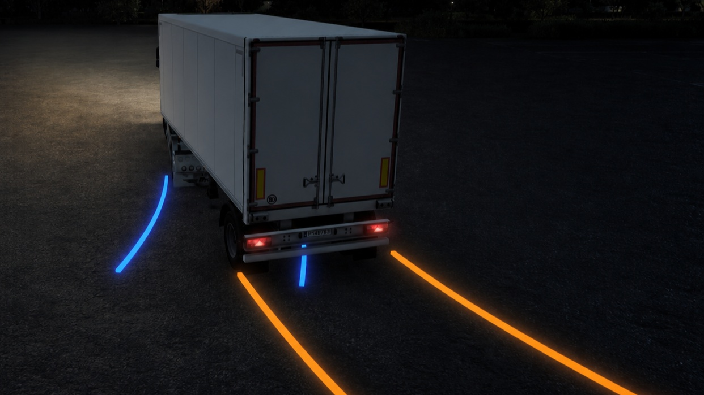

# Reverse Posture Assistant For ATS 1.62.x

An **American Truck Simulator only** reverse guidance mod for Windows x64. The current adaptation is **v1.62.2.2**, targeting installed ATS **1.62.2.2** (Steam Build 26761334).

[Steam Workshop](https://steamcommunity.com/sharedfiles/filedetails/?id=3792042919) · [Latest release · v1.62.2.2](https://github.com/yyysheng/ATSmods/releases/tag/reverse-trajectory-predictor-v1.62.2.2) · [Source folder](https://github.com/yyysheng/ATSmods/tree/main/mods/ATS_Reverse_Trajectory_Predictor)

**Game scope:** This Workshop item is for ATS. “Reverse Posture Assistant For ETS2 1.61.x” is a separate Euro Truck Simulator 2 mod and Workshop item.

While reversing, the mod predicts the tractor and trailer sweep path from SCS telemetry and draws collisionless guide lines in the game world. The path follows steering and trailer articulation; it is not a screen overlay.

## Version numbering

Starting with V1.62.2.2, the mod version matches its target game version. Historical v0.11.x releases keep their original numbers.

从 V1.62.2.2 起，模组版本号与适配游戏版本号一致，历史版本编号保留。

## Features

- Blue tractor and orange trailer boundaries over a fixed 5 m prediction path.
- Wheel-contact-aware prediction for liftable and steerable axles and different wheelbases.
- Ground grade fitted from grounded tyre centres and per-wheel suspension travel, not chassis pitch/roll alone. Changing front or rear suspension height by itself does not tilt the guide on level ground.
- A single-axle trailer reuses the tractor tyre fit only for the direction its own wheel layout cannot determine.
- Lines appear in reverse gear and hide outside reverse gear or while paused.
- World-space models use normal game rendering, including interior, exterior, and mirror views. The game's trailer guide markers remain unchanged.
- No cabin accessory is required. No camera, mirror-image, or depth-buffer capture; no bundled ReShade, `dxgi.dll`, or `d3d11.dll`.
- Native hooks run only on matching executable profiles. Unknown builds retain telemetry but skip native hooks.

## V1.62.2.2 · ATS compatibility and exit cleanup

Adds an exact profile for ATS 1.62.2.2. Trajectory rendering was confirmed by the user on the preceding build. This build ports early quit cleanup from ETS2; exit verification is pending. Historical MIT grants and third-party notices are retained. V1.62.2.2 activates proprietary terms for scheduled original code. Historical MIT grants and third-party licenses remain effective; assets are excluded.

## v0.11.3 · Ground-slope update

Road grade now follows grounded wheel centres reconstructed with per-wheel suspension travel. This prevents unequal suspension height from creating a false incline on level ground while preserving actual road slope.

## Installation

Choose **one** mod source: Full standalone or Steam Workshop. Do not enable both copies.

### Full standalone package

1. Download [Reverse_Posture_Assistant_For_ATS_v1.62.2.2_Full.zip](https://github.com/yyysheng/ATSmods/releases/download/reverse-trajectory-predictor-v1.62.2.2/Reverse_Posture_Assistant_For_ATS_v1.62.2.2_Full.zip).
2. Fully exit ATS, extract the ZIP, and run `Install-Full.bat`.
3. Enable **Reverse Posture Assistant For ATS 1.62.x** in the ATS Mod Manager, then restart the game.

### Steam Workshop package

1. Subscribe to the [ATS Workshop item](https://steamcommunity.com/sharedfiles/filedetails/?id=3792042919) and let Steam download its content.
2. Download [Reverse_Posture_Assistant_For_ATS_v1.62.2.2_Workshop.zip](https://github.com/yyysheng/ATSmods/releases/download/reverse-trajectory-predictor-v1.62.2.2/Reverse_Posture_Assistant_For_ATS_v1.62.2.2_Workshop.zip).
3. Fully exit ATS, extract the ZIP, and run `Install-Workshop.bat`.
4. Enable the Workshop item in the Mod Manager, disable any standalone copy, then restart ATS.

**A Workshop subscription does not install the required DLL.** Steam supplies mod resources; the Workshop ZIP on GitHub installs the runtime. The Full package contains both.

The installer copies `ATSReverseTrajectoryRuntime.dll` to `bin\win_x64` and also to `bin\win_x64\plugins` if that folder already exists. It does not modify `dxgi.dll` or `d3d11.dll`. When updating, exit ATS, update both resources and runtime, then restart.

## ATS compatibility

- **ATS 1.62.2.2**, Windows x64, Steam Build 26761334: exact executable profile, four hooks and four helpers checked.

- **ATS 1.61.3.1**, Windows x64: exact profiles for the supported Steam executables, including local executable file version 1.61.3.18.
- **ATS 1.61.2.0** and **1.61.1.1**, Windows x64: exact executable profiles.
- **ATS 1.60.1.8**, Windows x64: exact executable profile; other ATS 1.60 builds require matching enabled-hook signatures.
- Other or modified executables skip native hooks and retain telemetry-only mode.

## 中文说明

**Reverse Posture Assistant For ATS 1.62.x v1.62.2.2** 仅适用于 American Truck Simulator；欧卡 2 工坊中的 “Reverse Posture Assistant For ETS2 1.61.x” 是不同游戏、不同条目的独立模组。

倒挡时，模组根据 SCS 遥测在游戏世界中显示车头与挂车的预测扫掠边界：蓝色代表车头，橙色代表挂车，固定预测距离为 5 米。轨迹随方向盘、挂车夹角、车轮接地状态、提升状态和可转向轴变化。

坡度按接地轮胎中心与悬挂行程拟合，不再仅跟随车身俯仰/侧倾。因此，在平地上单独调整前后悬挂高度不会让轨迹线产生虚假倾斜；真实道路坡度仍保留。单轴挂车自身无法确定的方向会回退使用车头的轮胎坡度，而不是挂车车身姿态。

### 安装

完整包与工坊版二选一，不要同时启用：

1. **本地完整包：**下载 [v1.62.2.2 Full.zip](https://github.com/yyysheng/ATSmods/releases/download/reverse-trajectory-predictor-v1.62.2.2/Reverse_Posture_Assistant_For_ATS_v1.62.2.2_Full.zip)，完全退出美卡、解压并运行 `Install-Full.bat`。
2. 在模组管理器中启用“Reverse Posture Assistant For ATS 1.62.x”，然后重新启动美卡。
3. **创意工坊：**订阅[美卡工坊条目](https://steamcommunity.com/sharedfiles/filedetails/?id=3792042919)，等待 Steam 下载资源；另行下载 [v1.62.2.2 Workshop.zip](https://github.com/yyysheng/ATSmods/releases/download/reverse-trajectory-predictor-v1.62.2.2/Reverse_Posture_Assistant_For_ATS_v1.62.2.2_Workshop.zip)，退出美卡、解压并运行 `Install-Workshop.bat`。
4. 在模组管理器中启用工坊版、停用本地副本，再重新启动美卡。

仅订阅工坊不会自动安装 DLL。Steam 提供模组资源，GitHub 上的 Workshop 包安装运行组件；Full 完整包包含资源与运行组件。运行组件复制到 `bin\win_x64`，若已有 `plugins` 子文件夹也会同步复制。升级时请同时更新资源与 DLL。

无需驾驶室挂件。模组不抓取摄像头、后视镜画面或深度缓冲，不附带 ReShade、`dxgi.dll` 或 `d3d11.dll`。仅支持卡车车头与挂车；乘用车模式不显示倒车线。

### 美卡兼容版本

- **ATS 1.61.3.1**（Windows x64）：精确配置包含当前本机 Steam 可执行文件内部版本 1.61.3.18。
- **ATS 1.61.2.0、1.61.1.1**（Windows x64）：精确可执行文件配置。
- **ATS 1.60.1.8**（Windows x64）：精确配置；其他 ATS 1.60 构建须匹配已启用的 Hook 签名。
- 其他或修改过的可执行文件会跳过原生 Hook，仅保留遥测模式。

## Project information

- Author: [yyysheng](https://github.com/yyysheng)
- Telemetry API: SCS SDK
- Hook library: MinHook
- [Third-party notices](THIRD_PARTY_NOTICES.md) · [Build instructions](BUILDING.md) · [Workshop upload instructions](WORKSHOP_BUILDING.md)

